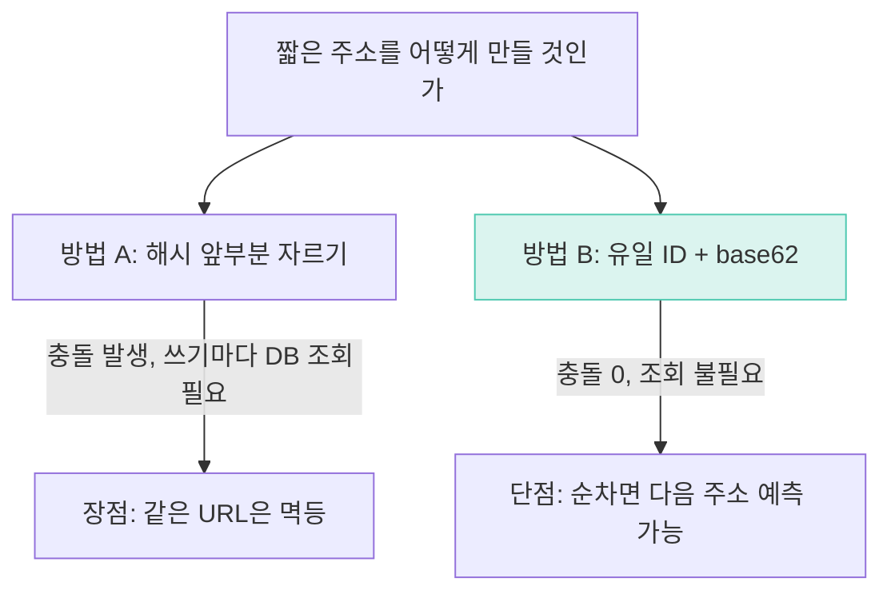

*NOTE << 요약자의 인사이트*
# URL 단축기 (URL Shortener)
- `POST`로 원본 URL을 받아 짧은 URL을 만들고, `GET`으로 짧은 URL을 원본으로 돌려보내는 서비스
- API는 단 두 개뿐인데 안쪽은 갈림길이 두 개다 — 그 갈림길이 이 장의 전부
- 원서 분량은 7장과 비슷한 얇은 장. 이번에도 한 편으로 끝

NOTE) [[7장 유일 ID 생성기]]와의 연결 — 8장은 짧은 주소를 만드는 방법 중 하나로 7장의 ID를 그대로 갖다 쓴다. 다만 7장이 "안 겹치게 크게 만드는" 문제였다면 8장은 그 값을 "짧게 줄이는" 문제라 방향이 반대다.

# 1단계 요구사항 — 규모 산정

책이 준 조건. 이 숫자들이 뒤 설계를 전부 결정한다.

```
쓰기   1억 개/일        →  1억 / 86400 = 약 1,160개/초
읽기   쓰기의 10배      →  약 11,600개/초
기간   10년             →  1억 x 365 x 10 = 3,650억 개
URL    평균 100바이트   →  약 36.5TB
```

⭐ **읽기가 쓰기의 10배**라는 게 이 장 전체의 전제다. 뒤의 캐시 절에서 그대로 회수된다.

API는 두 개뿐이다.
- `POST /api/v1/data/shorten` (본문: 원본 URL) → 짧은 URL 반환
- `GET /api/v1/{shortUrl}` → 301 또는 302로 원본으로 리디렉션

NOTE) API가 두 개뿐인데 안쪽이 깊다. 6장도 `get`/`put` 두 개였다. **API의 단출함이 설계의 단출함을 뜻하지 않는다** — 복잡함이 API 밖으로 밀려난 것뿐이다.

# 2단계 개략적 설계안

## 리디렉션 — 301 vs 302

| | 뜻 | 브라우저 | 서버 부하 | 클릭 통계 |
|---|---|---|---|---|
| 301 | 영구 이동 | 캐시함. 2회차부터 우리 서버 안 거침 | 낮다 | **못 낸다** |
| 302 | 임시 이동 | 캐시 안 함. 매번 거침 | 높다 | 낼 수 있다 |

**실제 단축 URL 서비스는 대부분 302를 쓴다.** 클릭 분석이 이 서비스의 존재 이유에 가깝기 때문이다. 부하를 감수하고 데이터를 산다.

## 왜 URL 단축기를 쓰는가

책이 안 짚는 대목이고 발표에서 첫 질문으로 나오기 쉽다.

NOTE) 원래 이유는 글자 수(트위터 140자 시절)였는데 **지금은 거의 죽은 이유**다. 진짜 이유는 **중간에 우리 서버를 한 번 거치게 만드는 것** — 클릭 추적이고, 짧아지는 건 부산물일 뿐이다. 목적지를 나중에 갈아끼울 수 있다는 것도 크다(명함·QR·인쇄물은 못 고치지만 목적지는 바꿔야 할 때가 있다) — 한 겹 끼워 넣어 나중을 열어두는 것, **간접 참조(indirection)**다. 대가도 있다 — 목적지가 안 보여 피싱에 쓰이고, 서비스가 죽으면 링크가 전부 죽는다.


## 짧은 주소를 몇 자로 할까

62자(a-z, A-Z, 0-9) 기준.

**실측 — base62 길이별 표현 가능 개수 (계산)**

```
 길이               경우의 수
   4             14,776,336
   5            916,132,832
   6         56,800,235,584
   7      3,521,614,606,208
   8    218,340,105,584,896

 필요량  1억/일 x 365 x 10 = 365,000,000,000
```

- 6자는 568억이라 3,650억 개를 못 담는다
- 7자는 3.5조로 여유 있게 담는다
- 8자부터는 남는 폭이 커질 뿐 결론에 영향이 없다

**7자로 결론난다.**

# 3단계 상세 설계 — 여기가 이 장의 핵심

**데이터 모델**: `id`(PK) · `shortURL` · `longURL`. 관계형 DB 한 벌로 시작한다.

**갈림길 두 개. 이게 8장의 전부다.** 둘 다 문제가 있다.

## 방법 A — 원본 URL을 해시해서 앞부분만 자른다

해시 후 충돌 해결 방식.

- 같은 URL이면 같은 짧은 주소가 나온다(멱등). 이건 장점
- 그런데 **충돌한다**

**실측 — 해시 앞 N자만 잘라 쓸 때 충돌 (2026-09-05, 라즈베리파이 5)**

URL 500만 개를 MD5 해서 앞 N자(16진수)만 사용.

```
       공간            충돌         비율
 앞 6자     16,777,216    675,776건   13.516%
 앞 7자    268,435,456     46,138건    0.923%
 앞 8자  4,294,967,296      2,903건    0.058%
```

- 앞 6자는 공간이 1,677만인데 500만 개(적재율 30%)에서 13.5%가 충돌한다
- 공간을 10배(6자→7자) 늘려도 충돌은 없어지지 않고 0.9%로 줄어드는 데 그친다
- 완전히 0이 되려면 공간을 표현 가능한 개수보다 훨씬 크게 남겨야 한다

NOTE) "공간이 넉넉하면 안 겹친다"가 여기서 틀린다 — **생일 문제**다. 30%만 채웠는데 13.5%가 충돌하는 건 직관과 정반대다. 두 사람의 생일이 같을 확률은 사람 수보다 훨씬 빠르게 올라간다는 그 문제와 원리가 같다 — 짝을 이루는 조합의 수가 원소 수보다 훨씬 빨리 늘기 때문이다.

- 충돌 처리: 뒤에 미리 정한 문자열을 붙여 재해시한다. 그런데 이 재해시가 필요한지부터 알려면 **넣기 전에 DB 조회가 필요**해진다 — 쓰기마다 조회가 붙는 게 이 방법의 비용이다
- 블룸 필터로 이 조회를 줄일 수 있다는 언급까지만 하고 넘어간다. 자세한 구조는 [[6장 키-값 저장소 설계]]에서 이미 다뤘다

## 방법 B — 유일 ID를 받아서 base62로 변환한다

- 충돌이 **원리적으로 0**이다. ID가 유일하니까
- 조회도 필요 없다 — 방법 A가 쓰기마다 치러야 했던 DB 조회 비용이 여기선 아예 없다

**실측 — base62 변환과 예측 가능성 (계산)**

```
              1  ->  1
             62  ->  10
         11,157  ->  2TX
  2,147,483,648  ->  2lkCB2
365,000,000,000  ->  6qpENMc
```

순차 카운터를 그대로 쓰면:

```
 발급 1번째:  short.ly/2TX
 발급 2번째:  short.ly/2TY
 발급 3번째:  short.ly/2TZ
 발급 4번째:  short.ly/2U0
 발급 5번째:  short.ly/2U1
 ...다음은?   short.ly/2U3
```

7장 스노우플레이크 ID를 그대로 base62 하면:

```
 64비트 ID :  1,831,086,432,056,381,482
 base62    :  2bgovtxy4sO   (11자)
```

- 충돌은 0인데 **다음 주소가 보인다.** 순차로 발급하면 남의 링크를 열어볼 수 있다
- [[7장 유일 ID 생성기]]가 여기서 되돌아온다 — ID를 어디서 받나가 7장의 답이다. 그런데 스노우플레이크 64비트 값을 그대로 base62 하면 값이 너무 커서 **11자**가 나온다. 1단계에서 정한 7자 목표를 넘는다
- 7장이 "안 겹치게 크게 만드는" 문제였다면 8장은 **"그걸 짧게 줄이는"** 문제다. 방향이 반대다

## 두 방법 비교

| | 방법 A (해시 앞부분) | 방법 B (유일 ID + base62) |
|---|---|---|
| 충돌 | 있음 (생일 문제) | 원리적으로 0 |
| 쓰기 시 DB 조회 | 필요 (충돌 확인) | 불필요 |
| 예측 가능성 | 낮음 (해시라 무작위에 가까움) | 순차면 높음 — 대응 필요 |
| 같은 URL 멱등성 | 있음 | 없음 (호출마다 새 주소) |
| 길이 제어 | 자름 자리 수로 직접 제어 | ID 크기에 종속 (스노우플레이크는 초과) |



## 저장 키를 무엇으로 할까

짧은 문자열을 PK로 둘 때와, 정수를 PK로 두고 응답할 때만 base62로 변환할 때의 차이.

**실측 — 키 타입별 인덱스 크기 (2026-09-05, 라즈베리파이 5, Postgres 16, 각 100만 행)**

```
  테이블   |  힙   | 인덱스 |  합계   | 실제 행수
-----------+-------+--------+---------+-----------
 char(7)   | 73 MB | 30 MB  | 102 MB  |   998,154
 bigint    | 73 MB | 21 MB  |  95 MB  | 1,000,000
```

NOTE) `char(7)` 쪽 행수가 100만이 아닌 것에 주목해야 한다 — MD5 앞 7자를 그대로 PK로 넣었더니 **1,846건이 충돌로 유실**됐다(`ON CONFLICT DO NOTHING`). 바로 앞 블록이 말한 충돌이 실제 테이블에서 **데이터 손실**로 나타난 것이다. 방법 A를 쓰려면 이 재해시 처리를 반드시 넣어야 한다는 뜻이다.

- 인덱스가 30MB vs 21MB. 정수 키가 1.43배 얇다
- 짧은 문자열도 정수보다는 넓다 — 그래서 실무에서는 정수를 PK로 두고, 응답할 때만 base62로 바꿔 보여주는 쪽을 많이 쓴다

# 마치며 — 확장

- **캐시** — 읽기가 쓰기의 10배니 여기가 승부처다. 짧은 URL → 원본 URL을 Redis에 올려두고, 캐시 미스 때만 DB를 본다. [[6장 키-값 저장소 설계]]에서 다룬 저장소가 이 캐시의 뒷단이 될 수 있다
- **처리율 제한** — 남용 방지. IP당 생성 횟수를 제한한다. [[4장 처리율 제한 장치의 설계]] 참고
- **DB 규모 확장** — 샤딩. 짧은 URL 자체를 샤드 키로 쓸 수 있다
- **가용성·일관성** — 웹 계층이 무상태라 수평 확장이 쉽다


URL 단축기가 주는 것.
- API는 `shorten`/`redirect` 두 개뿐이지만, 그 안에 해시 충돌·생일 문제·인덱스 크기·예측 가능성까지 다 들어 있다
- 방법 A와 B 둘 다 완전한 답이 아니다 — 실무는 보통 방법 B를 골라 예측 가능성 문제를 별도로 막는 쪽(문자 순서를 섞거나, 카운터에 오프셋을 더하는 식)을 취한다

실제로 쓰이는 곳.
- bit.ly, TinyURL, goo.gl 같은 단축 서비스
- 사내 메신저나 마케팅 툴에 내장된 링크 단축 기능

NOTE) 이 장이 안 푸는 것도 있다. 방법 B로 충돌은 없앴지만 **예측 가능성**은 별도 처방이 필요하고, 그 처방(문자 순서 셔플, 카운터 오프셋)은 책도 자세히 다루지 않는다. 결국 8장의 두 갈림길은 "완전한 답을 고르는 문제"가 아니라 **"어느 쪽 결함을 감당할지 고르는 문제"**였다 — 충돌을 감당하거나(방법 A), 예측 가능성을 감당하거나(방법 B).
