*NOTE << 요약자의 인사이트*
# 유튜브 (YouTube)
- 사용자가 영상을 올리고, 다른 사용자가 그 영상을 보는 서비스

책이 소개하는 유튜브의 규모 (2020년 무렵 수치).

```
월간 활성 사용자          20억 명
하루 시청 영상 수         50억 편
미국 성인 중 이용 비율    73%
창작자 수                 5,000만 명
광고 수입 (2019년)        150억 달러
모바일 인터넷 트래픽 비중  37%
지원 언어                 80개
```

# 1단계 요구사항 — 규모 산정

면접관과 주고받은 질문.

```
가장 중요한 기능      영상 올리기, 영상 보기
클라이언트            모바일 앱, 웹 브라우저, 스마트 TV
DAU                   500만 명
평균 시청 시간        하루 30분
다국어                지원
해상도                지금 쓰이는 해상도·형식 대부분
암호화                필요
영상 크기             작은·중간 크기, 최대 1GB
클라우드              써도 된다 (AWS·GCP·Azure)
```

집중할 품질 목표.
1. 빨리 올라가야 한다
2. 끊기지 않고 재생되어야 한다
3. 보는 사람이 화질을 바꿀 수 있어야 한다
4. 인프라 비용이 낮아야 한다
5. 가용성·규모 확장성·안정성이 높아야 한다

규모 추정.

```
한 사람 시청       하루 5편
업로드하는 사람    DAU 의 10%, 하루 1편씩
영상 평균 크기     300MB

하루 저장량    500만 × 10% × 300MB          = 150TB
하루 CDN 비용  500만 × 5편 × 0.3GB × $0.02  = $150,000
               (CloudFront 미국 기준 GB당 $0.02)
```

# 2단계 개략적 설계안 제시 및 동의 구하기

## 무엇을 직접 만들고 무엇을 빌려 쓰나

CDN 과 BLOB 저장소는 직접 만들지 않고 클라우드 서비스를 쓴다.
- 면접에서 할 일은 모든 것을 바닥부터 만드는 것이 아니라, 알맞은 기술을 골라 맞물리게 설계하는 것이다
- 규모를 키울 수 있는 BLOB 저장소나 CDN 을 직접 만드는 일은 매우 복잡하고 비용도 크다
- 큰 회사도 빌려 쓴다. 넷플릭스는 AWS 를, 페이스북은 아카마이(Akamai) CDN 을 쓴다

BLOB(Binary Large Object): 영상·이미지처럼 큰 이진 데이터를 하나의 덩어리로 보관하는 저장소. S3 가 대표적이다.

## 구성 요소 셋

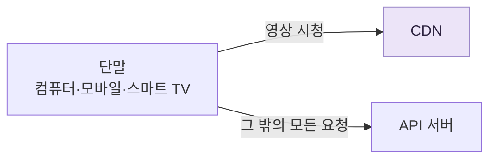

- **단말**: 컴퓨터, 모바일, 스마트 TV
- **CDN**: 영상을 저장해 두고 스트리밍한다
- **API 서버**: 영상 스트리밍을 뺀 나머지 전부. 피드 추천, 업로드 URL 생성, 메타데이터 DB·캐시 갱신, 회원 가입 등

이 장이 깊게 볼 흐름은 둘이다. **업로드 흐름**과 **스트리밍 흐름**.

## 비디오 업로드 절차

### 부품

```
사용자                  컴퓨터·모바일·스마트 TV 로 유튜브를 쓰는 사람
로드밸런서              API 서버 여러 대에 요청을 고르게 나눈다
API 서버                영상 스트리밍을 뺀 모든 요청을 처리한다
메타데이터 DB           영상의 메타데이터. 샤딩·다중화로 성능과 가용성을 맞춘다
메타데이터 캐시         메타데이터와 사용자 객체를 캐시한다
원본 저장소             올라온 원본 영상을 두는 BLOB 저장소
트랜스코딩 서버         영상 형식을 바꾼다. 단말·대역폭에 맞는 스트림을 만든다
트랜스코딩 비디오 저장소 변환이 끝난 영상을 두는 BLOB 저장소
CDN                     영상을 캐시한다. 재생 버튼을 누르면 여기서 스트리밍된다
트랜스코딩 완료 큐      「변환이 끝났다」는 이벤트를 담는 메시지 큐
트랜스코딩 완료 핸들러  완료 큐에서 이벤트를 꺼내 메타데이터 DB·캐시를 갱신하는 작업 서버
```

트랜스코딩(transcoding): 원본 영상을 풀어서 다른 코덱·해상도·비트레이트로 다시 만드는 작업. 비디오 인코딩이라고도 부른다.

업로드는 두 흐름이 **나란히** 진행된다.
- 흐름 ① 영상 업로드
- 흐름 ② 메타데이터 갱신

### 흐름 ① 영상 업로드

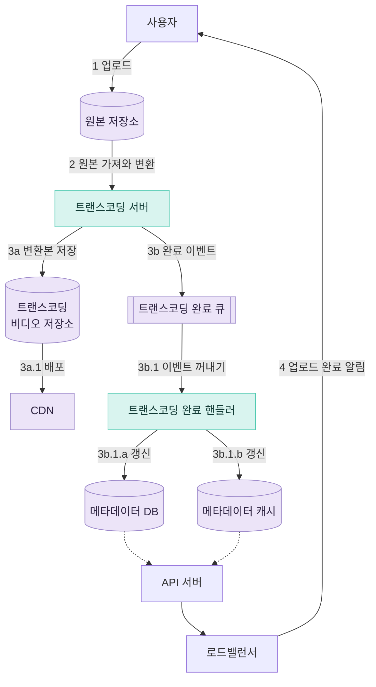

1. 영상을 원본 저장소에 올린다
2. 트랜스코딩 서버가 원본 저장소에서 영상을 가져와 변환한다
3. 변환이 끝나면 두 갈래가 **나란히** 진행된다
   - 3a. 변환된 영상을 트랜스코딩 비디오 저장소에 넣고, 3a.1. CDN 에 올린다
   - 3b. 완료 이벤트를 완료 큐에 넣고, 3b.1. 완료 핸들러가 이벤트를 꺼내 메타데이터 DB(3b.1.a)와 캐시(3b.1.b)를 갱신한다
4. API 서버가 단말에게 「업로드가 끝나 스트리밍할 준비가 됐다」고 알린다

### NOTE) 왜 병렬로 하는가

트랜스코딩 서버는 DB 를 직접 만지지 않는다. 변환본 저장(3a)과 나란히 완료 큐에 이벤트만 넣고(3b), DB·캐시 갱신은 완료 핸들러가 맡는다. 갱신 작업이 커서가 아니다. 갱신은 UPDATE 한 줄이다.

**1. DB 가 느리거나 죽어도 변환 결과를 잃지 않는다.**
몇 분 걸려 만든 변환이 끝났는데 DB 가 응답하지 않으면, 이벤트는 큐에 남아 있다가 나중에 다시 처리된다. 트랜스코딩 서버도 DB 를 기다리며 묶이지 않고 다음 영상으로 넘어간다.

**2. 트랜스코딩 서버 수천 대가 DB 연결을 들고 있지 않아도 된다.**
트랜스코딩 서버가 직접 갱신하면 서버마다 DB 커넥션 풀을 가져야 하고, 서버 수만큼 DB 연결이 늘어난다. 큐를 두면 DB 에 붙는 것은 완료 핸들러 몇 대뿐이다.

### 흐름 ② 메타데이터 갱신

영상이 원본 저장소로 올라가는 **동안**, 단말은 메타데이터 갱신 요청을 API 서버에 따로 보낸다. 요청에는 파일 이름·크기·형식 같은 정보가 들어 있고, API 서버는 이것으로 메타데이터 캐시와 DB 를 갱신한다.
## 비디오 스트리밍 절차

### 다운로드와 스트리밍

- **다운로드**: 영상 파일 전체를 단말로 받은 다음에 재생한다
- **스트리밍**: 영상을 다 받기 전에 재생을 시작하고, 보는 동안 나머지를 조금씩 계속 받는다

유튜브는 스트리밍이다. 재생 버튼을 누르면 곧바로 영상이 나와야 한다.

### 스트리밍 프로토콜

스트리밍 프로토콜: 영상을 스트리밍할 때 데이터를 어떤 형식과 순서로 주고받을지 정한 표준.

```
MPEG-DASH          Dynamic Adaptive Streaming over HTTP. 국제 표준
HLS                HTTP Live Streaming. 애플
스무드 스트리밍     Smooth Streaming. 마이크로소프트
HDS                HTTP Dynamic Streaming. 어도비
```

프로토콜마다 지원하는 영상 인코딩과 플레이어가 다르다. 그래서 서비스가 지원할 단말과 쓰임새에 맞게 골라야 한다.

NOTE) 넷 다 웹소켓이 아니라 **평범한 HTTP 요청**으로 통신한다. 영상을 몇 초짜리 조각 파일로 잘라 두고, 플레이어가 조각을 하나씩 요청해서 받아 간다(pull).

```
1. GET /video/123/master.m3u8     목록 파일 (화질별 조각 목록)
2. GET /video/123/720p/seg0.ts    첫 조각 (2~10초 분량)
3. GET /video/123/720p/seg1.ts    다음 조각
   ...                            보는 동안 계속 요청한다
```

웹소켓을 쓰지 않는 이유는 CDN 이다. HTTP 로 받는 조각은 그냥 정적 파일이라 CDN 이 캐시할 수 있고, 시청자 1만 명이 같은 조각을 요청해도 에지 서버가 캐시에서 내준다. 웹소켓은 서버가 시청자마다 연결을 붙잡고 직접 밀어 줘야 해서 CDN 이 캐시할 수 없다. 12장 채팅이 웹소켓을 쓴 것은 상대가 보낸 메시지를 서버가 **먼저** 밀어 줘야 했기 때문이고, 영상은 플레이어가 필요한 만큼 가져가면 된다.

### 영상은 CDN 에서 바로 받는다

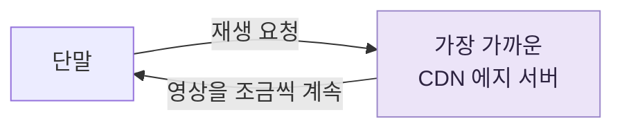

영상은 API 서버를 거치지 않고 CDN 에서 바로 스트리밍된다. 단말과 가장 가까운 CDN 에지 서버가 영상을 보내 주므로 전송 지연이 짧다.

# 3단계 상세 설계

## 비디오 트랜스코딩

녹화한 영상은 고화질·대용량이다. 그대로 두면 시간당 수백 GB 가 필요할 수 있다.

### 트랜스코딩이 필요한 이유

1. 가공하지 않은 원본은 저장 공간을 많이 차지한다. 초당 60프레임 HD 영상 한 시간이면 수백 GB 가 된다
2. 많은 단말과 브라우저는 특정 형식의 영상만 재생할 수 있다. 호환성을 위해 여러 형식으로 만들어 둔다
3. 네트워크 대역폭이 넉넉한 사용자에게는 고화질을, 부족한 사용자에게는 저화질을 보내야 끊김 없이 재생된다
4. 모바일 단말은 네트워크 상황이 수시로 바뀐다. 화질을 자동으로든 손으로든 바꾸려면 여러 화질이 미리 있어야 한다

### 비트레이트

비트레이트(bitrate): 영상을 구성하는 비트를 초당 얼마나 처리해야 하는지 나타내는 값. 비트레이트가 높으면 화질이 좋지만, 그만큼 처리 능력과 빠른 인터넷이 필요하다.

### 인코딩 형식 = 컨테이너 + 코덱

```
컨테이너   영상·소리·메타데이터를 담는 바구니
           파일 확장자로 구분한다       .avi  .mov  .mp4
코덱       화질은 지키면서 크기를 줄이는 압축·해제 알고리즘
                                        H.264  VP9  HEVC
```

## DAG 모델

트랜스코딩은 컴퓨팅 자원을 많이 쓰고 시간도 오래 걸린다. 게다가 창작자마다 원하는 처리가 다르다. 워터마크를 넣고 싶은 사람, 섬네일을 직접 고르고 싶은 사람, 고화질만 원하는 사람이 있다.

여러 처리 과정을 지원하면서 병렬성도 높이려면 추상화 계층을 하나 두고, 실행할 작업을 클라이언트 프로그래머가 직접 정의하게 해야 한다. 페이스북의 스트리밍 비디오 엔진은 이를 위해 **DAG**(Directed Acyclic Graph, 방향성 비순환 그래프) 프로그래밍 모델을 쓴다. 작업을 단계별로 배열해 순서대로 또는 나란히 실행할 수 있다.

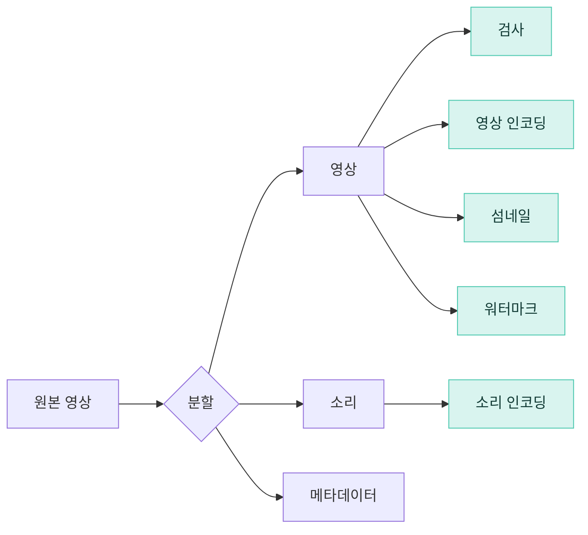

- **검사**: 영상이 좋은 품질인지, 손상되지 않았는지 확인한다
- **영상 인코딩**: 여러 해상도·코덱·비트레이트 조합으로 인코딩한다. 360p.mp4, 480p.mp4, 720p.mp4, 1080p.mp4, 4k.mp4 같은 결과가 나온다
- **섬네일**: 사용자가 올린 이미지를 쓰거나 시스템이 자동으로 만든다
- **워터마크**: 영상 위에 식별 정보를 담은 이미지를 덧씌운다

## 비디오 트랜스코딩 아키텍처

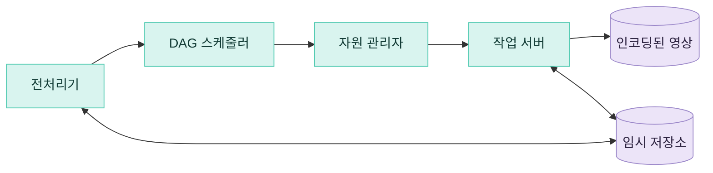

### 전처리기

1. **영상 분할**: 영상 스트림을 GOP 단위로 쪼갠다. 오래된 단말이나 브라우저는 GOP 단위로 쪼개서 올리지 못하므로 전처리기가 대신한다
2. **DAG 생성**: 클라이언트 프로그래머가 작성한 설정 파일에 따라 DAG 를 만든다
3. **데이터 캐시**: 분할한 GOP 와 메타데이터를 임시 저장소에 보관한다. 인코딩이 실패하면 이 보관본으로 다시 시도한다

GOP(Group of Pictures): 특정 순서로 배열된 프레임 묶음. GOP 하나는 혼자서 재생할 수 있고, 길이는 보통 몇 초다.

### DAG 스케줄러

DAG 를 몇 단계(stage)로 나누고, 각 단계의 작업을 자원 관리자의 작업 큐에 넣는다.

```
1단계   원본 영상을 영상·소리·메타데이터로 분할
2단계   영상 인코딩 · 섬네일 추출 · 소리 인코딩
```

### 자원 관리자

자원을 효과적으로 배분한다. 큐 셋과 작업 스케줄러로 이루어진다.

```
작업 큐         실행할 작업을 담은 우선순위 큐
작업 서버 큐    작업 서버의 가용 상태를 담은 우선순위 큐
실행 큐         지금 실행 중인 작업과 작업 서버 정보
작업 스케줄러   가장 알맞은 작업·서버 조합을 골라 실행을 지시
```

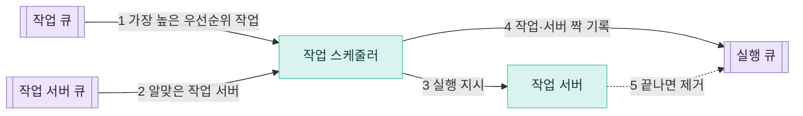

1. 작업 큐에서 우선순위가 가장 높은 작업을 꺼낸다
2. 그 작업을 실행하기에 알맞은 작업 서버를 작업 서버 큐에서 고른다
3. 작업 서버에 작업 실행을 지시한다
4. 어떤 작업을 어떤 서버가 맡았는지 실행 큐에 넣는다
5. 작업이 끝나면 실행 큐에서 지운다

### 작업 서버

DAG 에 정의된 작업을 실제로 수행한다. 작업 종류마다 서버 풀을 따로 둔다. 워터마크 서버, 인코딩 서버, 섬네일 서버, 병합 서버 등이다(책 확인).

### 임시 저장소

데이터의 유형·크기·이용 빈도·보관 기간에 따라 저장소를 골라 쓴다.
- 메타데이터는 작업 서버가 자주 읽고 크기가 작으므로 메모리 캐시에 둔다
- 영상·소리 데이터는 BLOB 저장소에 둔다
- 처리가 끝나면 임시 저장소의 데이터는 지운다

### 인코딩된 영상

처리 과정의 최종 결과물이다. 예를 들어 `funny_720p.mp4` 같은 파일이다.

## 시스템 최적화

### 속도 최적화

**1. 영상을 나눠서 병렬로 업로드한다.**
클라이언트가 영상을 GOP 경계에 맞춰 작은 조각으로 나눠 올린다. 업로드가 빨라지고, 일부가 실패해도 그 조각부터 다시 올리면 된다.

**2. 업로드 센터를 사용자 가까이 둔다.**
지역마다 업로드 센터를 둔다. CDN 을 업로드 센터로 쓸 수 있다.

**3. 모든 절차를 병렬화한다.**
각 모듈을 메시지 큐로 느슨하게 연결한다. 큐가 없으면 인코딩 모듈은 다운로드 모듈이 끝나기를 기다려야 한다. 큐를 두면 인코딩 모듈은 큐에 이벤트가 들어오는 대로 처리하므로 여러 작업이 나란히 진행된다.

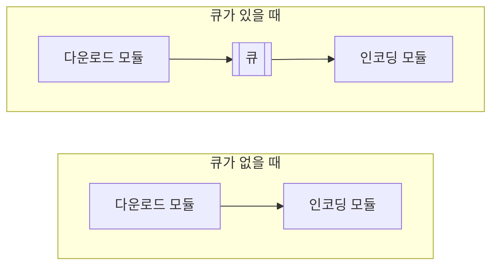

### 안전성 최적화

**1. 사전 서명 업로드 URL.**
허가받은 사용자만, 정해진 장소에 영상을 올리게 한다.

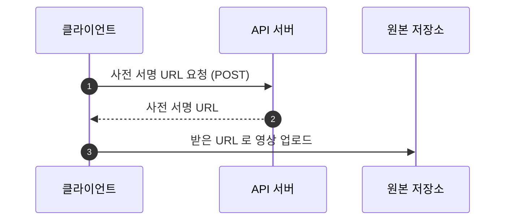

사전 서명 URL 은 AWS S3 에서 쓰는 이름이다. Azure 는 같은 기능을 공유 액세스 서명(SAS, Shared Access Signature)이라고 부른다.

**2. 영상 보호.**
저작권이 있는 영상이 무단으로 퍼지지 않게 한다.
- **DRM**(디지털 저작권 관리): 애플 페어플레이, 구글 와이드바인, 마이크로소프트 플레이레디
- **AES 암호화**: 영상을 암호화하고 접근 권한을 설정한다. 재생할 때만 복호화하고, 허락받은 사용자만 볼 수 있다
- **워터마크**: 영상 위에 소유자 정보를 담은 이미지를 덧씌운다

### 비용 최적화

CDN 은 비싸다. 그런데 유튜브의 영상 시청은 **롱테일 분포**를 따른다. 인기 영상 일부가 아주 많이 재생되고, 나머지 대부분은 거의 재생되지 않는다.

1. 인기 영상만 CDN 으로 내보내고, 나머지는 고용량 저장소를 가진 영상 서버에서 내보낸다
2. 인기 없는 영상은 미리 인코딩하지 않아도 된다. 짧은 영상이라면 요청이 올 때 인코딩한다
3. 특정 지역에서만 인기 있는 영상은 다른 지역으로 옮기지 않는다
4. CDN 을 직접 만들고 인터넷 서비스 제공자(ISP)와 제휴한다. ISP 는 전 세계 어디에나 있고 사용자와 가깝다. 넷플릭스의 Open Connect 가 그 예다

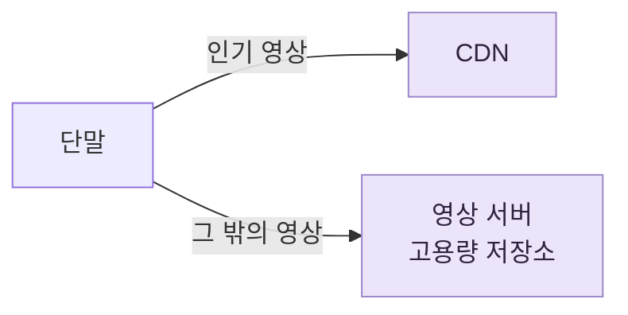

이런 최적화는 모두 콘텐츠 인기도, 이용 패턴, 영상 크기 같은 데이터에 근거한다. 최적화하기 전에 과거 시청 패턴부터 분석해야 한다.

## 오류 처리

```
회복 가능 오류     특정 영상 조각의 트랜스코딩 실패 등
                   → 몇 번 다시 시도한다. 계속 실패하면 클라이언트에 오류 코드를 돌려준다
회복 불가능 오류   영상 형식이 잘못된 경우 등
                   → 그 영상의 작업을 멈추고 클라이언트에 오류 코드를 돌려준다
```

부품별 대응.

```
업로드 오류              몇 번 다시 시도한다
영상 분할 오류           오래된 클라이언트가 GOP 경계로 못 나누면
                         영상 전체를 서버로 보내 서버가 나눈다
트랜스코딩 오류          다시 시도한다
전처리 오류              DAG 를 다시 만든다
DAG 스케줄러 오류        작업을 다시 스케줄링한다
자원 관리자 큐 장애      사본(replica)을 쓴다
작업 서버 장애           다른 서버에서 그 작업을 다시 시도한다
API 서버 장애            API 서버는 무상태이므로 새 요청을 다른 API 서버로 보낸다
메타데이터 캐시 장애     데이터가 여러 벌이므로 다른 노드에서 읽는다
                         죽은 캐시 서버는 새 서버로 바꾼다
메타데이터 DB 장애       주 서버가 죽으면 부 서버 하나를 주 서버로 올린다
                         부 서버가 죽으면 다른 부 서버로 읽고, 죽은 서버는 바꾼다
```

# 4단계 마무리

시간이 남으면 더 이야기할 것.

- **API 계층의 규모 확장**: API 서버는 무상태라 수평으로 늘리기 쉽다
- **DB 계층의 규모 확장**: 다중화와 샤딩
- **라이브 스트리밍**: 영상을 실시간으로 녹화하며 방송하는 것. 업로드·인코딩·스트리밍이라는 뼈대는 같지만 다른 점이 있다
  - 응답 지연이 더 짧아야 하므로 스트리밍 프로토콜을 신중히 골라야 한다
  - 작은 데이터를 실시간으로 빠르게 처리해야 하므로 병렬화의 효과가 작다
  - 오래 걸리는 오류 처리 방법은 쓸 수 없다
- **영상 내리기**(takedown): 저작권 위반, 선정적인 영상, 불법 영상은 내려야 한다. 일부는 업로드 과정에서 걸러 내고, 나머지는 사용자 신고로 찾아낸다

# 책 읽기 전에 그려 본 업로드 흐름

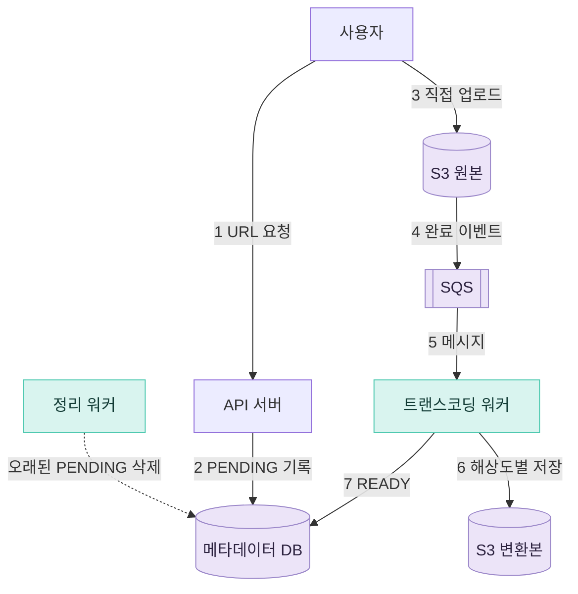

# 책을 읽고 다시 그린 설계

## 업로드 흐름

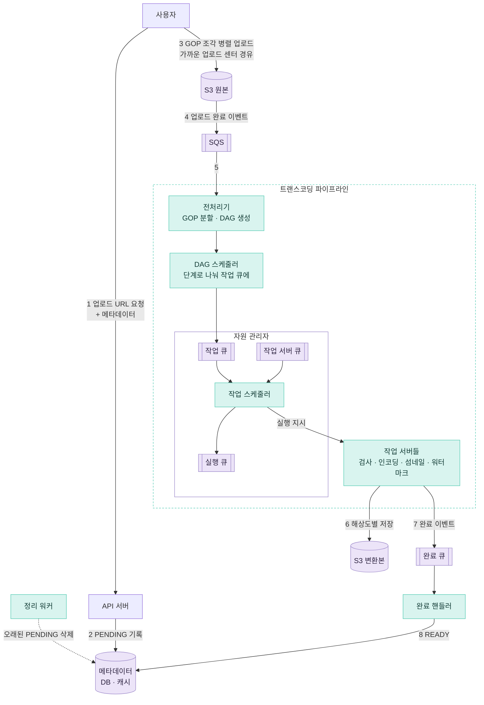

## 재생 흐름

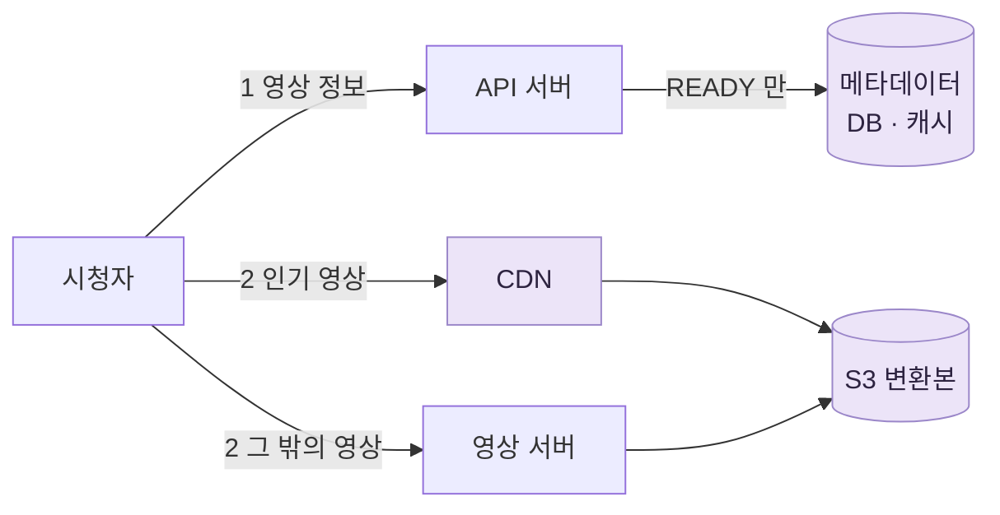

# 번외편 — 실제 유튜브는 어떻게 하나

구글은 유튜브의 전체 구조도를 공개한 적이 없다. 아래는 공개 API 문서, 구글 논문, 구글 블로그를 이어 붙여 다시 짠 것이다.

## 책의 변환 구조는 페이스북에서 왔다

클라이언트가 GOP 로 잘라 올리고, 오래된 클라이언트 영상은 전처리기가 대신 자르고, DAG 스케줄러와 작업 서버와 임시 저장소를 두는 구조는 페이스북의 SVE(Streaming Video Engine) 논문(SOSP 2017)과 거의 같다. 책도 「페이스북의 스트리밍 비디오 엔진은 DAG 모델을 쓴다」고 밝힌다.

## 전체 흐름

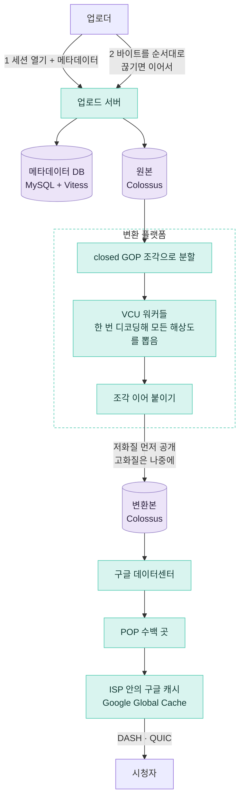

## 업로드

```
책    클라이언트가 GOP 로 잘라 조각을 병렬로 올린다
실제  바이트를 순서대로 올린다. 끊기면 서버에
      어디까지 받았는지 묻고 그다음 바이트부터 잇는다
```

- **재개 가능한 업로드(resumable upload).** 첫 요청으로 업로드 세션을 열고 세션 URI 를 받는다. 끊기면 빈 PUT 을 보내고, 서버는 308 응답의 Range 헤더로 받은 범위를 알려 준다. 조각 크기는 256KB 의 배수다.
- 책이 GOP 분할로 얻는 「실패한 부분만 다시 올린다」를 유튜브는 바이트 위치로 얻는다. GOP 로 자르는 일은 서버가 한다.
- **메타데이터가 먼저 간다.** 업로드 세션을 여는 첫 요청 본문에 제목·설명 같은 메타데이터를 넣는다.
- **처리 상태는 조회한다.** `processingStatus` 는 processing / succeeded / failed / terminated 이고, 진행률은 `partsProcessed / partsTotal`, 곧 「몇 조각 중 몇 조각」으로 준다.
- 위 내용은 외부 개발자용 공개 API(YouTube Data API v3) 기준이다. 유튜브 스튜디오 웹과 모바일 앱의 내부 방식은 공개되지 않았다.

## 트랜스코딩

```
책    범용 작업 서버가 해상도마다 따로 인코딩한다
실제  전용 칩(VCU)이 한 번 디코딩해서
      모든 해상도를 한꺼번에 뽑는다
```

- **전용 칩 VCU(Video Coding Unit).** 2015년에 설계를 시작해 2021년에 공개했다. 소프트웨어 인코딩보다 연산 효율이 20~33배 높다. 카드 한 장에 VCU 2개, 서버 한 대에 20개가 들어간다. 범용 CPU 로 VP9 를 만들면 2160p 5초 조각 하나에 벽시계 시간 15분, CPU 시간 1시간 넘게 들었다.
- **조각 병렬 처리는 책과 같다.** 서버가 영상을 closed GOP 조각으로 나눠 병렬 워커에 보내고, 결과를 이어 붙인다.
- **다른 점은 MOT(multiple-output transcoding)다.** 책의 DAG 처럼 해상도마다 따로 인코딩하는 것을 SOT(single-output)라 부르는데, 디코딩을 해상도 수만큼 반복하는 낭비가 있다. 유튜브는 한 번 디코딩해 모든 해상도를 뽑는 MOT 를 주로 쓴다.
- **변환은 업로더와 가까운 데이터센터에서 한다.** 그 지역 용량이 모자라면 전역 스케줄러가 더 먼 곳으로 보낸다.
- **코덱은 H.264, VP9(구글 자체 코덱), AV1 이다.** 2015년 VP9 로 대역폭을 평균 35% 줄였다.

## 인기에 따라 다르게 만든다

```
책    인기 없는 영상은 덜 만든다
실제  모든 영상을 기본 화질로 만들고,
      인기 영상에 더 비싼 처리를 얹는다
```

- 인기도를 세 등급으로 나눈다.
  - 시청 시간 대부분을 차지하는 소수의 인기 영상은 처리 비용을 더 써서 시청자 대역폭을 줄인다.
  - 적당히 보이는 영상은 중간 정도로 처리한다.
  - 대다수인 롱테일 영상은 재생만 되게 비용을 최소로 쓴다.
  - 옛 영상이 뒤늦게 뜨면 높은 등급으로 다시 처리한다.
- VCU 이전에는 VP9 를 가장 인기 있는 영상에만, 업로드 뒤 배치로 만들었다. VCU 이후에는 업로드 때 H.264 와 VP9 를 둘 다 만든다.
- **저화질부터 공개한다.** 1080p 와 4K 는 나중에 붙는다. 60분짜리 4K 30fps 영상은 고화질 처리에 최대 4시간이 걸린다. 그래서 「준비됨」이 한 번이 아니라 화질별로 늘어난다.
- 같은 변환 플랫폼이 유튜브, 유튜브 라이브, 구글 포토, 구글 드라이브를 함께 처리한다. 작업은 용도(업로드·라이브)와 우선순위(critical·normal·batch) 두 축으로 나눠 스케줄링한다.

## 저장

- **영상은 Colossus 에 둔다.** 구글의 분산 파일 시스템으로 GFS 의 후속이다. 구글 클라우드 블로그가 「유튜브·드라이브·지메일을 받치는 같은 저장 시스템」이라고 밝혔다.
- **메타데이터는 MySQL 을 샤딩해 썼다.** 2006~07년에 주-부 복제의 복제 지연 문제를 겪고 샤딩으로 갔다. 섬네일은 작은 파일이 너무 많아 Bigtable 로 옮겼다.
- 2010년에는 샤딩을 애플리케이션 코드에서 떼어 내는 프록시 계층 **Vitess** 를 만들었다. 지금은 CNCF 졸업 프로젝트다. 지금도 유튜브가 Vitess 를 쓰는지는 공식 자료가 없다.

## 전송

```
책    인기 영상은 CDN, 나머지는 영상 서버.
      CDN 은 빌려 쓰고 GB 당 요금을 낸다
실제  구글 자체 망 세 겹으로 보낸다.
      외부 CDN 요금을 내지 않는다
```

- **책의 「인기 영상만 CDN」은 2006~07년 유튜브의 방식이다.** 가장 인기 있는 영상은 CDN 으로 보내고, 하루 1~20회 보는 영상은 코로케이션 시설의 유튜브 서버에서 보냈다.
- **지금은 구글 자체 망이다.**
  - 구글 데이터센터
  - 전 세계 수백 곳의 POP(ISP 와 직접 연결하는 거점)
  - ISP 망 안의 GGC(Google Global Cache): 구글이 서버를 무상으로 넣고 ISP 는 랙·전원·포트를 댄다. 그 ISP 가입자에게 인기 있는 콘텐츠를 캐시하고, 캐시할 수 있는 트래픽의 70~90% 를 처리한다.
- 캐시에 없는 영상은 위층으로 거슬러 올라가 가져온다. 그 구간은 구글 사설 백본망이다.
- 책이 마지막 비용 최적화로 미뤄 둔 「ISP 와 제휴해 직접 CDN 을 만든다」가 유튜브에서는 기본 구조다. 책이 예로 든 넷플릭스의 Open Connect 와 같은 일이다.
- **스트리밍 프로토콜은 MPEG-DASH 다.** 2015년 HTML5 플레이어를 기본으로 바꿀 때 적응형 비트레이트로 버퍼링이 전 세계 평균 50% 넘게 줄었다. 2025년부터 웹 플레이어가 SABR 라는 자체 프로토콜로 바뀌었다는 외부 분석이 있다. 구글 공식 문서가 아니라 역공학 관찰이다.
- **전송 계층은 QUIC 이다.** 2017년 논문에서 QUIC 이 유튜브 재버퍼링 비율을 데스크톱 18.0%, 모바일 15.3% 줄였다.

## 책에 없는 것

- **Content ID.** 업로드되는 모든 영상을 저작권자가 낸 참조 파일(소리·영상)과 자동으로 대조한다. 걸리면 저작권자가 정한 대로 차단, 수익 가져가기(광고), 시청 통계 추적 중 하나를 한다.
- **규모.** 분당 500시간 넘는 영상이 올라온다(2021). 2025년 3월 기준 하루 2,000만 편 넘게 올라온다는 20주년 발표 보도가 있다.

## 출처

- YouTube Data API 재개 가능한 업로드 — https://developers.google.com/youtube/v3/guides/using_resumable_upload_protocol
- YouTube Data API videos 리소스 — https://developers.google.com/youtube/v3/docs/videos
- Huang et al., "SVE: Distributed Video Processing at Facebook Scale", SOSP 2017 — https://www.cs.princeton.edu/~wlloyd/papers/sve-sosp17.pdf
- Ranganathan et al., "Warehouse-Scale Video Acceleration: Co-design and Deployment in the Wild", ASPLOS 2021 — https://research.google/pubs/pub50300/
- 유튜브 공식 블로그, VCU 공개(2021) — https://blog.youtube/inside-youtube/new-era-video-infrastructure/
- 유튜브 고객센터, 업로드 뒤 화질이 낮음 — https://support.google.com/youtube/answer/71674
- 구글 클라우드 블로그, Colossus — https://cloud.google.com/blog/products/storage-data-transfer/a-peek-behind-colossus-googles-file-system
- Vitess 역사 — https://vitess.io/docs/overview/history/
- High Scalability, "YouTube Architecture"(2008) — https://highscalability.com/youtube-architecture/
- 구글 클라우드 블로그, 구글 네트워크(2022) — https://cloud.google.com/blog/products/infrastructure/google-network-infrastructure-investments/
- Google Global Cache 안내 — https://support.google.com/interconnect/answer/9058809
- InfoQ, 유튜브 HTML5 기본 전환(2015) — https://www.infoq.com/news/2015/01/youtube-html5-player-default
- yt-dlp 이슈 #12482, SABR — https://github.com/yt-dlp/yt-dlp/issues/12482
- Langley et al., "The QUIC Transport Protocol", SIGCOMM 2017 — https://research.google/pubs/pub46403/
- 유튜브 고객센터, Content ID — https://support.google.com/youtube/answer/2797370
